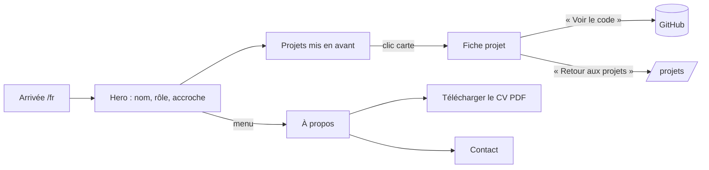
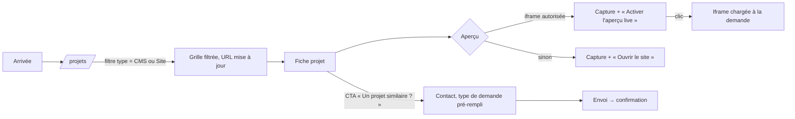
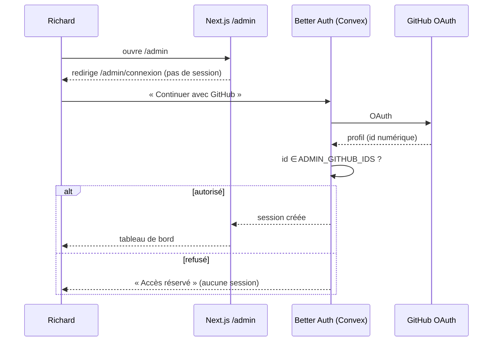
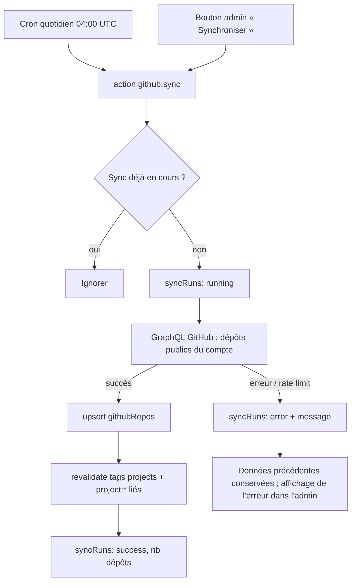
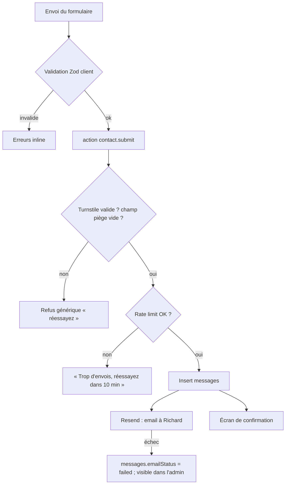

# APP FLOW — Portfolio

> v1.0 · 2026-10-12
> Docs liés : [PRD](PRD.md) · [TRD](TRD.md) · [BACKEND_SCHEMA](BACKEND_SCHEMA.md) · [DESIGN_BRIEF](DESIGN_BRIEF.md)

## 1. Plan du site (routes)

| Route | Accès | Contenu | Données |
|---|---|---|---|
| `/` | public | Redirection vers `/fr` ou `/en` selon `Accept-Language` | — |
| `/[locale]` | public | Accueil : hero, projets mis en avant, compétences clés, CTA | `profile`, `projects` (featured) |
| `/[locale]/projets` (`/en/projects`) | public | Grille filtrable | `projects` publiés + `githubRepos` |
| `/[locale]/projets/[slug]` | public | Fiche projet | `project` + `githubRepo` lié |
| `/[locale]/a-propos` (`/en/about`) | public | Bio, parcours, compétences, CV | `profile`, `experiences`, `skills` |
| `/[locale]/contact` | public | Formulaire | — (écrit `messages`) |
| `/[locale]/mentions-legales` (`/en/legal`) | public | Mentions légales et confidentialité | statique (messages i18n) |
| `/admin/connexion` | public | Bouton « Continuer avec GitHub » | — |
| `/admin` | admin | Tableau de bord : état de la sync, derniers messages, raccourcis | `syncRuns`, `messages` |
| `/admin/projets` | admin | Liste triable (glisser-déposer), filtres statut | `projects` |
| `/admin/projets/nouveau` · `/admin/projets/[id]` | admin | Éditeur de projet (onglets FR/EN) | `projects`, `githubRepos`, fichiers |
| `/admin/profil` | admin | Profil, liens, CV FR/EN | `profile` |
| `/admin/competences` · `/admin/experiences` | admin | Listes ordonnables | `skills`, `experiences` |
| `/admin/github` | admin | Dépôts synchronisés, import en projet, « synchroniser » | `githubRepos`, `syncRuns` |
| `/admin/messages` | admin | Boîte de réception | `messages` |
| `/admin/export` | admin | Télécharger le JSON complet | toutes les tables |
| `/api/revalidate` | secret | Invalidation du cache Next.js | — |
| `/sitemap.xml` · `/robots.txt` · `opengraph-image` | public | SEO | `projects` publiés |

Les slugs d'URL publiques sont traduits via la configuration `pathnames` de next-intl.

## 2. Parcours visiteur

### 2.1 Recruteur (objectif : juger le profil en < 3 min)

### 2.2 Client potentiel (objectif : voir des sites réels puis écrire)

### 2.3 Changement de langue

Sélecteur dans l'en-tête → même page dans l'autre langue (slug traduit) ; préférence mémorisée par cookie `NEXT_LOCALE`.

## 3. Parcours admin

### 3.1 Connexion

### 3.2 Créer et publier un projet

1. `/admin/projets/nouveau` → saisie : titre FR/EN, slug (généré, modifiable), type, résumé, description (Markdown), stack, tags, dates, liens, dépôt GitHub (optionnel, autocomplétion depuis `githubRepos`).
2. Upload de la couverture et de la galerie (compression côté client avant envoi).
3. **URL du site renseignée** → action `previews.inspect` : vérifie `X-Frame-Options` et la CSP `frame-ancestors` → propose `iframe` ou `capture` ; si `capture`, lance `previews.capture` (Microlink) → image stockée.
4. Enregistrement automatique en **brouillon** (debounce 1 s, indicateur « Enregistré »).
5. « Publier » → `status = "published"`, `publishedAt` → action `revalidate.trigger(["projects", "project:<slug>"])` → visible publiquement en quelques secondes.
6. Toast de confirmation avec lien « Voir sur le site ».

### 3.3 Importer un dépôt GitHub comme projet

`/admin/github` → liste des dépôts synchronisés (ceux déjà liés sont marqués) → « Créer un projet » → brouillon pré-rempli (titre, description, langages en stack, URL homepage, lien dépôt) → éditeur de projet.

### 3.4 Messages

Nouveau message → badge dans la navigation admin (temps réel) → lecture = `read` → archivage possible. L'email de notification contient un lien direct vers le message.

## 4. Flux système

### 4.1 Sync GitHub

### 4.2 Formulaire de contact

Le message est **toujours enregistré avant** l'envoi de l'email : aucune perte même si Resend échoue.

### 4.3 Captures d'écran

À la création, quand l'URL change, sur demande (bouton « Recapturer »), et par cron hebdomadaire pour les projets en mode `capture`. En cas d'échec : la capture précédente est conservée, l'erreur est affichée dans l'éditeur.

## 5. États d'interface à prévoir

| Écran | Chargement | Vide | Erreur |
|---|---|---|---|
| Grille projets | Squelettes de cartes (aucun saut de mise en page) | « Aucun projet pour ces filtres » + bouton « Réinitialiser » | Page d'erreur de route avec « Réessayer » |
| Fiche projet | Rendu serveur (pas de chargement) | — | 404 dédiée si slug inconnu ou non publié |
| Aperçu iframe | Capture affichée en fond pendant le chargement | — | Bascule sur la capture si l'iframe ne charge pas en 8 s |
| Stats GitHub | — | Bloc masqué si pas de dépôt lié | « Données du JJ/MM » si la dernière sync a échoué |
| Contact | Bouton en état d'envoi, désactivé | — | Message d'erreur conservant la saisie |
| Admin (toutes listes) | Squelettes | État vide avec action principale | Toast d'erreur + valeur précédente restaurée |

## 6. Navigation

- **Public** : en-tête fixe compact (logo/nom · Projets · À propos · Contact · sélecteur FR/EN · thème clair/sombre), pied de page (liens sociaux, mentions légales, © année). Changer de thème change aussi la loi du champ génératif (transformation ↔ traceur), voir [DESIGN_BRIEF](DESIGN_BRIEF.md).
- **Mobile** : menu plein écran accessible (focus piégé, fermeture Échap).
- **Admin** : barre latérale (Tableau de bord, Projets, Profil, Compétences, Expériences, GitHub, Messages, Export) + lien « Voir le site ».
- **Clavier** : lien « Aller au contenu », ordre de focus logique, `⌘K` / `Ctrl+K` dans l'admin pour la recherche rapide (V1.1 si le temps manque).
