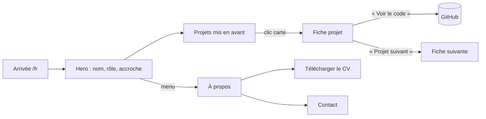
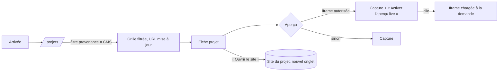
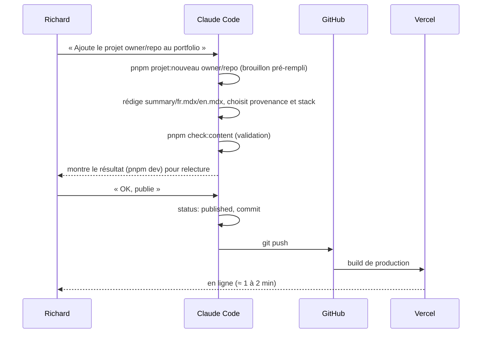
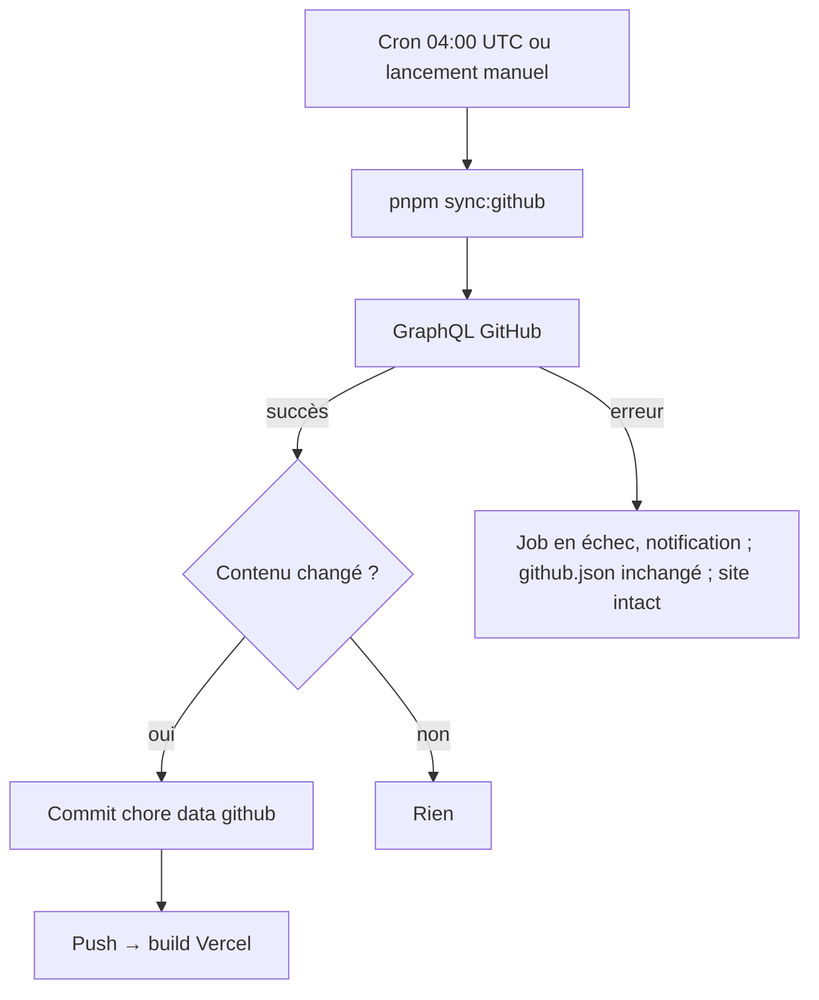
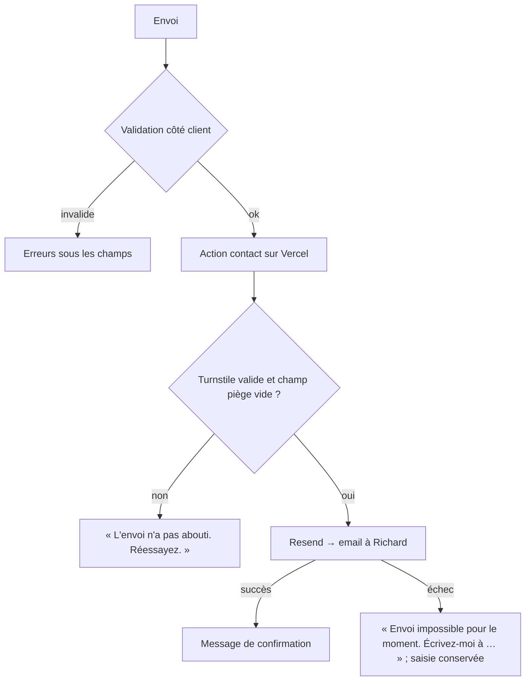

# APP FLOW — Portfolio

> v1.1 · 2026-10-12 (révisé : site statique, publication via Claude Code, sans admin)
> Docs liés : [PRD](PRD.md) · [TRD](TRD.md) · [BACKEND_SCHEMA](BACKEND_SCHEMA.md) · [DESIGN_BRIEF](DESIGN_BRIEF.md)

## 1. Plan du site (routes)

| Route FR | Route EN | Contenu | Rendu |
|---|---|---|---|
| `/` | — | Redirection vers `/fr` ou `/en` selon la langue du navigateur | Redirection |
| `/fr` | `/en` | Accueil : hero + champ génératif, projets mis en avant, fabrications, profil court, contact | Prérendu |
| `/fr/projets` | `/en/projects` | Grille filtrable | Prérendu (+ îlot filtres) |
| `/fr/projets/[slug]` | `/en/projects/[slug]` | Fiche projet | Prérendu (+ îlot aperçu) |
| `/fr/a-propos` | `/en/about` | Bio, parcours, compétences, CV | Prérendu |
| `/fr/contact` | `/en/contact` | Formulaire | Prérendu (+ îlot formulaire → action serveur) |
| `/fr/mentions-legales` | `/en/legal` | Mentions légales et confidentialité | Prérendu |
| `/404` | — | Page introuvable bilingue | Prérendu |

## 2. Parcours visiteur

### 2.1 Recruteur (objectif : juger le profil en moins de 3 min)

### 2.2 Visiteur qui découvre les réalisations (objectif : voir les sites et y aller)

### 2.3 Changement de langue et de thème

- Langue : sélecteur dans l'en-tête → même page dans l'autre langue (slug traduit) ; préférence mémorisée.
- Thème : bouton dans l'en-tête → bascule clair/sombre, mémorisée ; par défaut, préférence système. Sur l'accueil, la loi du champ change (transformation ↔ traceur), voir [DESIGN_BRIEF](DESIGN_BRIEF.md).

## 3. Parcours éditeur (Richard)

### 3.1 Ajouter un projet

Cible PRD : moins de 5 min de la demande à la mise en ligne.

### 3.2 Modifier ou retirer

- Modifier : demande à Claude Code → édition du fichier → push.
- Retirer : `status: archived` (reste dans le dépôt, absent du site) ou suppression du dossier.
- Mettre en avant : `featured: true` + `order` (6 maximum, vérifié au build).

### 3.3 Projets hébergés ailleurs (CMS, sites clients existants)

Même dossier, sans `repo` : `liveUrl` + provenance `cms` + `platform` (« WordPress »…). La capture est automatique ; une capture manuelle `cover.webp` prime si l'automatique est mauvaise.

## 4. Flux système

### 4.1 Sync GitHub (quotidienne)

### 4.2 Captures et autorisation iframe (hebdomadaire)

Pour chaque projet publié avec `liveUrl` et sans `cover` : vérification des en-têtes (iframe autorisée ?) → capture Playwright → comparaison avec la précédente → commit si différence > 2 %. Échec sur un site : la capture précédente est conservée, l'échec est listé dans le résumé du job.

### 4.3 Formulaire de contact

### 4.4 Build

Lecture des fichiers → validation des schémas et règles (BACKEND_SCHEMA §3) → génération des pages FR/EN, des images optimisées, des images OG et du sitemap → déploiement. Un contenu invalide arrête le build ; la production reste sur la version précédente.

## 5. États d'interface

| Écran | Chargement | Vide | Erreur |
|---|---|---|---|
| Grille projets | Aucun (HTML statique) | « Aucun projet pour ces filtres » + « Réinitialiser les filtres » | — |
| Fiche projet | Aucun | — | 404 si slug inconnu ou non publié |
| Aperçu iframe | La capture reste affichée pendant le chargement | — | Retour à la capture si l'iframe n'a pas chargé en 8 s |
| Stats GitHub | — | Bloc masqué si pas de dépôt lié | — (instantané toujours présent) |
| Champ génératif | SVG statique de la première image | — | WebGL2 absent → Canvas 2D ; échec → SVG statique |
| Contact | Bouton en état d'envoi, désactivé | — | Message d'erreur, saisie conservée |

## 6. Navigation

- **En-tête** fixe de 64 px : nom · Projets · À propos · Contact · FR/EN · thème.
- **Mobile** : menu plein écran (focus retenu, fermeture par Échap).
- **Pied de page** : liens sociaux, mentions légales, © année.
- **Clavier** : lien « Aller au contenu », ordre de focus logique, focus visible partout.
