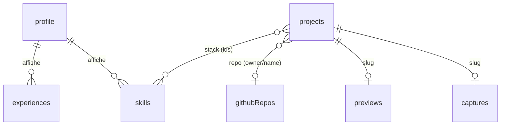

# BACKEND SCHEMA — Portfolio

> v1.1 · 2026-10-12 (révisé : pas de base de données ; contenu en fichiers, instantanés générés, une fonction serveur)
> Docs liés : [PRD](PRD.md) · [TRD](TRD.md) · [APP_FLOW](APP_FLOW.md)

## 1. Vue d'ensemble

Le « back-end » se compose de trois couches :

| Couche | Où | Écrit par | Lu par |
|---|---|---|---|
| **Contenu** (profil, projets, compétences, parcours) | `src/content/` | Richard via Claude Code | Build Astro (collections typées) |
| **Instantanés** (GitHub, aperçus, captures) | `src/data/`, `src/assets/captures/` | Jobs GitHub Actions | Build Astro |
| **Fonction serveur** (contact) | `src/actions/` | — | Vercel Function à la demande |



## 2. Arborescence du contenu

```
src/content/
  profile.yaml                 # document unique
  skills.yaml                  # liste
  experiences.yaml             # liste
  projects/
    atelier-lumen/             # dossier = slug (kebab-case)
      meta.yaml                # champs structurés + textes courts FR/EN
      fr.mdx                   # description longue FR
      en.mdx                   # description longue EN (optionnelle)
      cover.webp               # optionnel : prime sur la capture auto
      gallery/                 # optionnel : images de galerie
src/data/
  github.json                  # instantané GitHub (bot)
  previews.json                # autorisation iframe par projet (bot)
src/assets/captures/
  atelier-lumen.webp           # capture auto (bot)
public/cv/
  cv-fr.pdf · cv-en.pdf
```

## 3. Schémas (`src/content.config.ts`)

```ts
import { defineCollection, reference } from "astro:content";
import { z } from "astro/zod"; // Zod 4 : z.email(), z.url()
// Implémentation réelle : schémas dans src/lib/content/schemas.ts, partagés avec scripts/check-content.ts
import { glob, file } from "astro/loaders";

const localized = z.object({ fr: z.string().min(1), en: z.string().default("") });
const slug = z.string().regex(/^[a-z0-9]+(-[a-z0-9]+)*$/);
const yearMonth = z.string().regex(/^\d{4}(-\d{2})?$/); // « 2026 » ou « 2026-03 »

const profile = defineCollection({
  loader: file("src/content/profile.yaml"),
  schema: ({ image }) => z.object({
    fullName: z.string(),
    role: localized,              // « Développeur web »
    tagline: localized,           // accroche du hero (≤ 20 mots, vérifié)
    bio: localized,               // Markdown court
    location: localized.optional(),
    portrait: image().optional(),
    email: z.email().optional(),   // dépôt public : laissé vide, contact via CONTACT_TO_EMAIL (Vercel)
    showEmail: z.boolean().default(false),
    githubLogin: z.string(),      // compte synchronisé
    socials: z.array(z.object({
      kind: z.enum(["github", "linkedin", "x", "bluesky", "website", "other"]),
      url: z.string().url(),
      label: z.string().optional(),
    })),
  }),
});

const skills = defineCollection({
  loader: file("src/content/skills.yaml"),
  schema: z.object({
    id: slug,                     // « nextjs »
    name: z.string(),             // « Next.js »
    category: z.enum(["language", "framework", "cms", "tool", "design", "other"]),
    showOnAbout: z.boolean().default(true),
    order: z.number().int(),
  }),
});

const experiences = defineCollection({
  loader: file("src/content/experiences.yaml"),
  schema: z.object({
    id: slug,
    kind: z.enum(["work", "education", "freelance"]),
    title: localized,
    organization: z.string(),
    location: localized.optional(),
    description: localized.optional(),
    start: yearMonth,
    end: yearMonth.optional(),    // absent = en cours
    order: z.number().int(),
  }),
});

const projects = defineCollection({
  loader: glob({ pattern: "*/meta.yaml", base: "src/content/projects",
                 generateId: ({ entry }) => entry.split("/")[0] }),
  schema: ({ image }) => z.object({
    title: localized,
    summary: localized,           // 1 à 2 phrases (cartes, OG)
    role: localized.optional(),
    provenance: z.enum(["claude-code", "hand-coded", "cms", "other"]),
    platform: z.string().optional(),          // « WordPress »… si cms
    stack: z.array(reference("skills")).default([]),
    tags: z.array(z.string().toLowerCase()).default([]),
    status: z.enum(["draft", "published", "archived"]).default("draft"),
    featured: z.boolean().default(false),
    order: z.number().int().default(100),
    start: yearMonth.optional(),
    end: yearMonth.optional(),
    liveUrl: z.string().url().optional(),
    repo: z.string().regex(/^[\w.-]+\/[\w.-]+$/).optional(), // « owner/name »
    cover: image().optional(),                // prime sur la capture auto
    gallery: z.array(z.object({ src: image(), alt: localized })).default([]),
    preview: z.object({
      mode: z.enum(["auto", "iframe", "screenshot", "none"]).default("auto"),
    }).default({ mode: "auto" }),
  }),
});

const projectBodies = defineCollection({
  loader: glob({ pattern: "*/{fr,en}.mdx", base: "src/content/projects" }),
  // id = « atelier-lumen/fr » ; pas de frontmatter requis
});

export const collections = { profile, skills, experiences, projects, projectBodies };
```

**Règles vérifiées au build** (fonction `validateContent()` appelée par une intégration Astro, échec = build en erreur avec le fichier et le champ fautifs) :
- Un projet `published` a `fr.mdx`, un `summary.fr`, et une image (`cover` ou capture auto existante) ; sinon erreur.
- `summary.en` / `en.mdx` absents → **avertissement** (pas d'échec) listé en fin de build.
- `featured: true` → maximum 6 projets ; sinon erreur.
- `repo` déclaré mais absent de `github.json` → avertissement (sera rempli au prochain sync).
- `tagline` ≤ 20 mots par langue (règle du DESIGN_BRIEF).
- Aucun tiret cadratin dans les champs `title`, `summary`, `tagline` (règle du DESIGN_BRIEF §7).

## 4. Instantanés générés

### 4.1 `src/data/github.json`

```json
{
  "generatedAt": "2026-10-12T04:00:12Z",
  "login": "richard",
  "repos": {
    "richard/compagnon": {
      "url": "https://github.com/richard/compagnon",
      "description": "Renard compagnon de bureau",
      "homepageUrl": null,
      "stars": 3, "forks": 0, "isArchived": false,
      "primaryLanguage": "TypeScript",
      "languages": [{ "name": "TypeScript", "color": "#3178c6", "percent": 87.4 }],
      "topics": ["claude-code"],
      "pushedAt": "2026-10-11T18:22:00Z",
      "lastCommit": { "message": "Renard v2 : repos", "date": "2026-10-11T18:20:00Z", "sha": "a1b2c3d" }
    }
  }
}
```
- Script `scripts/sync-github.ts` : une requête GraphQL (dépôts publics du compte, non forks) ; en cas d'erreur réseau ou de quota, **le fichier existant est conservé** et le job échoue proprement (notification GitHub), le site continue de servir l'instantané précédent.
- Commit uniquement si le contenu (hors `generatedAt`) change.

### 4.2 `src/data/previews.json`

```json
{ "atelier-lumen": { "iframeAllowed": false, "checkedAt": "2026-10-13T05:00:00Z", "reason": "x-frame-options: SAMEORIGIN" } }
```
- Script `scripts/captures.ts` : pour chaque projet `published` avec `liveUrl` et sans `cover` : requête `HEAD`/`GET` → lecture `X-Frame-Options` / CSP `frame-ancestors` ; capture Playwright 1440×900 → WebP qualité 80 dans `src/assets/captures/<slug>.webp`. Commit si la capture diffère au-delà d'un seuil (2 % de pixels).
- **Mode d'aperçu effectif** = `preview.mode` du projet s'il n'est pas `auto`, sinon `iframe` si `iframeAllowed`, sinon `screenshot`.

## 5. Fonction serveur : action de contact

`src/actions/index.ts` (Astro Actions, route à la demande sur Vercel) :

```ts
export const server = {
  contact: defineAction({
    accept: "form",
    input: z.object({
      name: z.string().trim().min(1).max(100),
      email: z.string().trim().email().max(254),
      topic: z.enum(["job", "project", "other"]),
      message: z.string().trim().min(10).max(5000),
      locale: z.enum(["fr", "en"]),
      sourcePath: z.string().max(200).optional(),
      website: z.string().max(0).optional(),        // champ piège : doit rester vide
      "cf-turnstile-response": z.string().min(1),
    }),
    handler: async (input, ctx) => {
      // 1. vérifier Turnstile (secret, IP du client) → sinon ActionError FORBIDDEN (message générique)
      // 2. envoyer via Resend à CONTACT_TO_EMAIL, reply-to = input.email, sujet « [Portfolio] {topic} : {name} »
      // 3. succès → { ok: true } ; échec Resend → ActionError INTERNAL_SERVER_ERROR (message invitant à écrire directement)
    },
  }),
};
```

- Aucune donnée stockée. Journaux Vercel sans contenu du message (seulement statut et durée).
- Test : Turnstile et Resend simulés (Vitest) ; E2E avec les clés de test officielles Turnstile.

## 6. Outils de publication

| Commande | Rôle |
|---|---|
| `pnpm projet:nouveau <owner/repo \| url>` | Crée `src/content/projects/<slug>/` : `meta.yaml` pré-rempli (titre, résumé depuis la description GitHub, stack déduite des langages, `liveUrl` = homepage, `status: draft`) et `fr.mdx` depuis le README (nettoyé). Claude Code complète ensuite les textes. |
| `pnpm sync:github` | Régénère `github.json` (aussi lancé par le job quotidien). |
| `pnpm captures [slug]` | Régénère captures et `previews.json` (aussi lancé par le job hebdomadaire). |
| `pnpm check:content` | Valide le contenu sans build complet. |

## 7. Routes générées

| Route | Type | Données |
|---|---|---|
| `/fr`, `/en` + pages | Prérendue | Collections + instantanés |
| `/[locale]/projets/[slug]` | Prérendue (`getStaticPaths` sur les projets publiés) | Projet + corps + repo + aperçu |
| `/og/[locale]/[slug].png` | Prérendue (satori + resvg) | Titre, provenance, sceau |
| `/sitemap-index.xml`, `/robots.txt` | Prérendue | Projets publiés |
| `/_actions/contact` | **À la demande** (Vercel Function) | Formulaire |

## 8. Évolutions possibles

- **Keystatic** : peut lire et écrire exactement ces fichiers (mêmes dossiers) pour une admin sans base ; aucun changement de schéma requis.
- **Base de données** (Convex/Neon) : seulement si une fonction l'exige (comptes, espace client). Les schémas Zod ci-dessus servent alors de contrat de migration.
