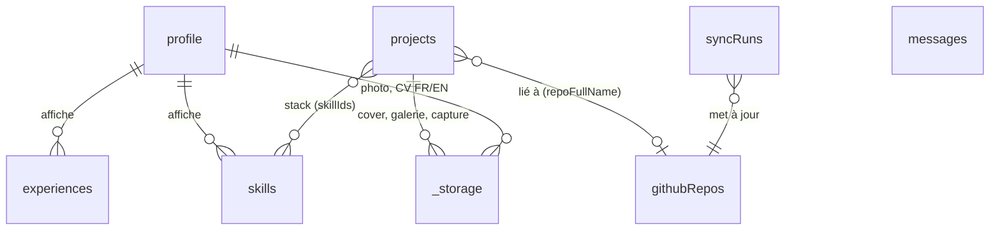

# BACKEND SCHEMA — Portfolio

> v1.0 · 2026-10-12 · Back-end : Convex
> Docs liés : [PRD](PRD.md) · [TRD](TRD.md) · [APP_FLOW](APP_FLOW.md)

## 1. Vue d'ensemble



- **Base** : documents Convex, typés par `convex/schema.ts` (types TS générés automatiquement).
- **Fichiers** : stockage Convex (`_storage`), référencés par `Id<"_storage">`.
- **Tables d'auth** : gérées par le composant Better Auth (`user`, `session`, `account`, `verification`) dans son propre espace ; non décrites ici.
- **Champ traduisible** : type `localized = { fr: string, en: string }`.

## 2. Schéma (`convex/schema.ts`)

```ts
import { defineSchema, defineTable } from "convex/server";
import { v } from "convex/values";

export const localized = v.object({ fr: v.string(), en: v.string() });

export const projectType = v.union(
  v.literal("claude-code"), // site ou app générés avec Claude Code
  v.literal("hand-coded"),  // codé à la main
  v.literal("cms"),         // WordPress, Webflow, Shopify…
  v.literal("other"),
);

export const previewMode = v.union(
  v.literal("iframe"),
  v.literal("screenshot"),
  v.literal("none"),
);

export default defineSchema({
  // Document unique (singleton) — créé au premier lancement
  profile: defineTable({
    fullName: v.string(),
    role: localized,               // « Développeur web »
    tagline: localized,            // accroche du hero
    bio: localized,                // Markdown
    location: v.optional(localized),
    availability: v.optional(localized), // « Disponible pour missions »
    photoId: v.optional(v.id("_storage")),
    cvFrId: v.optional(v.id("_storage")),
    cvEnId: v.optional(v.id("_storage")),
    email: v.string(),             // affiché ou non selon showEmail
    showEmail: v.boolean(),
    socials: v.array(v.object({
      kind: v.union(v.literal("github"), v.literal("linkedin"), v.literal("x"),
                    v.literal("bluesky"), v.literal("website"), v.literal("other")),
      url: v.string(),
      label: v.optional(v.string()),
    })),
    githubLogin: v.string(),       // compte à synchroniser
    updatedAt: v.number(),
  }),

  projects: defineTable({
    slug: v.string(),              // unique, kebab-case, commun aux deux langues
    title: localized,
    summary: localized,            // 1–2 phrases (cartes, OG)
    body: localized,               // Markdown (fiche)
    role: v.optional(localized),   // « Conception et développement »
    type: projectType,
    platform: v.optional(v.string()), // « WordPress », « Webflow »… si type = cms
    tags: v.array(v.string()),     // libres, en minuscules
    skillIds: v.array(v.id("skills")), // stack
    status: v.union(v.literal("draft"), v.literal("published"), v.literal("archived")),
    featured: v.boolean(),
    order: v.number(),             // tri manuel (glisser-déposer)
    startedAt: v.optional(v.string()),  // ISO « 2026-03 »
    endedAt: v.optional(v.string()),    // absent = en cours
    liveUrl: v.optional(v.string()),
    repoFullName: v.optional(v.string()), // « owner/repo » → githubRepos
    coverId: v.optional(v.id("_storage")),
    gallery: v.array(v.object({ fileId: v.id("_storage"), alt: localized })),
    preview: v.object({
      mode: previewMode,
      screenshotId: v.optional(v.id("_storage")),
      checkedAt: v.optional(v.number()),     // dernière inspection iframe
      capturedAt: v.optional(v.number()),
      lastError: v.optional(v.string()),
    }),
    publishedAt: v.optional(v.number()),
    updatedAt: v.number(),
  })
    .index("by_slug", ["slug"])
    .index("by_status_order", ["status", "order"])
    .index("by_status_featured", ["status", "featured", "order"])
    .index("by_repo", ["repoFullName"]),

  skills: defineTable({
    name: v.string(),              // « Next.js » (non traduit)
    category: v.union(v.literal("language"), v.literal("framework"), v.literal("cms"),
                      v.literal("tool"), v.literal("design"), v.literal("other")),
    level: v.optional(v.union(v.literal(1), v.literal(2), v.literal(3))), // usage interne
    showOnAbout: v.boolean(),
    order: v.number(),
  }).index("by_category_order", ["category", "order"]),

  experiences: defineTable({
    kind: v.union(v.literal("work"), v.literal("education"), v.literal("freelance")),
    title: localized,
    organization: v.string(),
    location: v.optional(localized),
    description: v.optional(localized),
    startedAt: v.string(),
    endedAt: v.optional(v.string()),
    order: v.number(),
  }).index("by_order", ["order"]),

  // Copie en cache des données GitHub (jamais éditée à la main)
  githubRepos: defineTable({
    fullName: v.string(),          // « owner/repo »
    name: v.string(),
    description: v.optional(v.string()),
    url: v.string(),
    homepageUrl: v.optional(v.string()),
    isPrivate: v.boolean(),
    isFork: v.boolean(),
    isArchived: v.boolean(),
    stars: v.number(),
    forks: v.number(),
    primaryLanguage: v.optional(v.string()),
    languages: v.array(v.object({ name: v.string(), color: v.optional(v.string()), percent: v.number() })),
    topics: v.array(v.string()),
    pushedAt: v.string(),          // dernier push (ISO)
    lastCommit: v.optional(v.object({ message: v.string(), date: v.string(), sha: v.string() })),
    readmeExcerpt: v.optional(v.string()), // 500 premiers caractères en texte brut
    syncedAt: v.number(),
  }).index("by_fullName", ["fullName"]),

  syncRuns: defineTable({
    kind: v.literal("github"),
    trigger: v.union(v.literal("cron"), v.literal("manual")),
    status: v.union(v.literal("running"), v.literal("success"), v.literal("error")),
    startedAt: v.number(),
    finishedAt: v.optional(v.number()),
    reposUpdated: v.optional(v.number()),
    error: v.optional(v.string()),
  }).index("by_kind_started", ["kind", "startedAt"]),

  messages: defineTable({
    name: v.string(),              // ≤ 100 caractères
    email: v.string(),             // ≤ 254, format validé
    topic: v.union(v.literal("job"), v.literal("project"), v.literal("other")),
    body: v.string(),              // ≤ 5 000 caractères
    locale: v.union(v.literal("fr"), v.literal("en")),
    sourcePath: v.optional(v.string()), // page d'origine (ex. fiche projet)
    status: v.union(v.literal("new"), v.literal("read"), v.literal("archived")),
    emailStatus: v.union(v.literal("pending"), v.literal("sent"), v.literal("failed")),
    createdAt: v.number(),
  }).index("by_status_created", ["status", "createdAt"]),
});
```

**Règles d'intégrité appliquées dans les mutations** (Convex n'a pas de contraintes déclaratives) :
- `projects.slug` unique (vérifié via `by_slug` avant insertion/modification) ; format `^[a-z0-9]+(-[a-z0-9]+)*$`.
- Un projet `published` doit avoir `title.fr`, `summary.fr` et `coverId` ; les champs `en` vides déclenchent un avertissement (pas un blocage).
- `profile` : une seule ligne (créée par `profile.ensure`).
- Suppression d'un projet → suppression des fichiers non référencés ailleurs (`coverId`, `gallery`, `screenshotId`).
- Suppression d'un skill → retrait de son id dans `projects.skillIds`.

## 3. Fonctions (API Convex)

Convention : `public.*` = lecture publique (sans auth, uniquement le contenu publié) ; `admin.*` = toutes protégées par `requireAdmin(ctx)` ; `internal.*` = appelables seulement par d'autres fonctions ou crons.

### 3.1 Lecture publique (queries)

| Fonction | Arguments | Retour |
|---|---|---|
| `public.profile.get` | — | profil + URLs signées (photo, CV) |
| `public.projects.list` | `{ type?, tag?, skillId? }` | projets `published` triés par `order`, avec repo GitHub lié (champs utiles) |
| `public.projects.featured` | — | projets `published` + `featured` (max 6) |
| `public.projects.bySlug` | `{ slug }` | projet publié + repo + skills, ou `null` |
| `public.projects.slugs` | — | slugs publiés (`generateStaticParams`, sitemap) |
| `public.skills.list` | — | skills `showOnAbout` groupés par catégorie |
| `public.experiences.list` | — | expériences triées |

### 3.2 Contact (action publique)

| Fonction | Arguments | Effets |
|---|---|---|
| `public.contact.submit` | `{ name, email, topic, body, locale, sourcePath?, turnstileToken, honeypot }` | Vérifie Turnstile + champ piège + rate limit → `internal.messages.insert` → `internal.email.notify` (planifié) |

### 3.3 Administration

| Domaine | Fonctions |
|---|---|
| Session | `admin.me` (renvoie l'admin ou `null`) |
| Profil | `admin.profile.update` |
| Projets | `admin.projects.list`, `get`, `create`, `update`, `publish`, `unpublish`, `archive`, `remove`, `reorder({ ids[] })`, `setFeatured` |
| Aperçus | `admin.previews.inspect({ projectId })` (action), `admin.previews.capture({ projectId })` (action) |
| Skills / expériences | `admin.skills.*`, `admin.experiences.*` (CRUD + `reorder`) |
| Fichiers | `admin.files.generateUploadUrl`, `admin.files.remove` |
| GitHub | `admin.github.syncNow` (action), `admin.github.repos`, `admin.github.importAsProject({ fullName })`, `admin.github.lastRuns` |
| Messages | `admin.messages.list({ status })`, `setStatus`, `unreadCount` |
| Export | `admin.export.all` (action → JSON complet avec URLs de fichiers) |

### 3.4 Interne et crons

| Fonction | Déclencheur | Rôle |
|---|---|---|
| `internal.github.sync` | cron quotidien 04:00 UTC + `syncNow` | GraphQL GitHub → upsert `githubRepos` → revalidation |
| `internal.previews.refreshAll` | cron hebdomadaire (lundi 05:00 UTC) | Recapture des projets en mode `screenshot` (dans la limite du quota) |
| `internal.revalidate.trigger` | après publication, modification d'un projet publié, sync | `POST {SITE_URL}/api/revalidate` avec `REVALIDATE_SECRET` et liste de tags |
| `internal.email.notify` | après insertion d'un message | Resend → met à jour `emailStatus` ; 3 tentatives avec délai croissant |
| `internal.syncRuns.cleanup` | cron hebdomadaire | Garde les 50 derniers runs |

## 4. Tags de cache Next.js

| Tag | Invalidé par |
|---|---|
| `profile` | `admin.profile.update` |
| `projects` | toute modification d'un projet publié, publication/dépublication, `reorder`, sync GitHub |
| `project:<slug>` | modification de ce projet ou de son dépôt lié |
| `skills`, `experiences` | mutations correspondantes |

## 5. Sécurité des fonctions

```ts
// convex/lib/auth.ts (esquisse)
export async function requireAdmin(ctx: QueryCtx | MutationCtx | ActionCtx) {
  const user = await authComponent.getAuthUser(ctx);          // Better Auth
  const githubId = user && await getGithubAccountId(ctx, user); // via table account
  if (!githubId || !ADMIN_GITHUB_IDS.includes(githubId)) throw new ConvexError("FORBIDDEN");
  return user;
}
```

- Test automatique : chaque fonction `admin.*` appelée sans identité ou avec un compte non autorisé doit lever `FORBIDDEN` (test paramétré sur la liste exportée des fonctions admin).
- Les queries publiques ne renvoient jamais `messages`, `draft`, `archived`, `profile.email` si `showEmail = false`.

## 6. Format de l'export JSON

```json
{
  "version": 1,
  "exportedAt": "2026-10-12T20:00:00Z",
  "profile": { "...": "..." },
  "projects": [ { "...": "...", "files": { "cover": "https://…", "gallery": ["https://…"] } } ],
  "skills": [], "experiences": [], "githubRepos": []
}
```

`messages` est exclu par défaut (données personnelles) ; option « inclure les messages » dans l'admin. Le JSON exporté peut être versionné dans un dépôt privé.

## 7. Migration future (si besoin)

Le schéma est relationnel dans sa forme (ids, index) : une migration vers Postgres (Neon) + Drizzle reste directe à partir de l'export JSON. Aucune logique métier ne dépend de fonctionnalités exclusives à Convex hormis le temps réel de l'admin.
